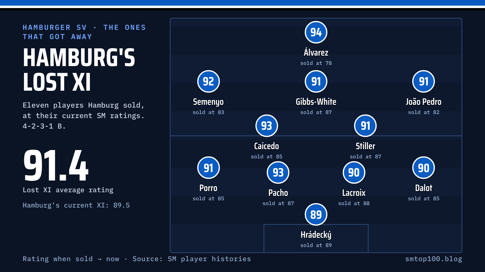

# The Ones That Got Away

# Hamburg's Lost XI

_Twenty-two players rated 89 to 94, all of them once on Hamburg's books, all of them sold. Put the best eleven together and they'd be favourites for the Division 1 title. Hamburg, meanwhile, are in Division 2._

* * *

After [relegation](https://smtop100.blog/2026/11/18/too-clever-by-half/), I did what every sensible manager does after a bad season. I went looking for something to make me feel worse.

I scrolled through the transfer history of every 89+ rated player in Top 100 and counted the ones who used to play for Hamburg.

It took a while.

* * *

# The Lost XI

| Position | Player | Sold | At | Now |
| --- | --- | --- | --- | --- |
| GK | Lukáš Hrádecký | Aug 2020 | 89 | 89 |
| RB | Pedro Porro | Jan 2020 | 85 | 91 |
| CB | Willian Pacho | Jun 2023 | 87 | 93 |
| CB | Maxence Lacroix | Aug 2025 | 88 | 90 |
| LB | Diogo Dalot | Jan 2021 | 85 | 90 |
| DM | Moisés Caicedo | Oct 2022 | 85 | 93 |
| DM | Angelo Stiller | Dec 2023 | 87 | 91 |
| AM | Morgan Gibbs-White | May 2024 | 87 | 91 |
| RW | Antoine Semenyo | Dec 2023 | 83 | 92 |
| LW | João Pedro | Apr 2022 | 82 | 91 |
| CF | Julián Álvarez | Dec 2019 | 78 | 94 |
| **Average** | | | | **91.4** |

Lined up in our usual 4-2-3-1 B, the Lost XI averages **91.4**. Our actual first team averages 89.5.

The ones that got away are nearly two points better than the ones that stayed.

* * *

# The Bench

And they wouldn't even need the subs bench to be any good. Yet it is:

| Player | Pos | Sold | At | Now |
| --- | --- | --- | --- | --- |
| Bryan Mbeumo | AM/F | Jul 2021 | 83 | 91 |
| John McGinn | M/AM | Aug 2016 | 81 | 91 |
| Giorgio Scalvini | D/DM | Jan 2022 | 75 | 90 |
| Mario Gila | D | Dec 2022 | 78 | 90 |
| Johnny Cardoso | DM/M | Mar 2023 | 82 | 90 |
| Kang-In Lee | M/AM | Oct 2022 | 85 | 90 |
| Mohammed Kudus | AM/F | Sep 2022 | 83 | 90 |
| Pascal Gross | D/DM/M | Dec 2017 | 87 | 90 |
| Waldemar Anton | D | Mar 2017 | 82 | 90 |
| Marc Pubill | D | Aug 2022 | 76 | 89 |
| Samu Aghehowa | F | Dec 2023 | 82 | 89 |

Scalvini is 22. Pubill is 23. Aghehowa is 22. They'll be better than most of my current squad for years.

* * *

# Paying Them to Leave

The worst part isn't who I sold. It's what I sold them for.

The usual story goes like this: a promising youngster, rated in the low-to-mid 80s, swapped for an established star whose best days were about to be behind him. That trade sounds sensible at the time. It rarely is.

Sometimes I didn't even get the star for free. In several deals Hamburg **added cash** to the youngster:

* **Angelo Stiller**, **Georginio Rutter** and **£20m** for Mason Mount.
* **Moisés Caicedo** and **£12m** for Mason Greenwood.
* **Mohammed Kudus** and **£10m** for Lorenzo Insigne.
* **Kang-In Lee** and **£5m** for Alex Oxlade-Chamberlain.
* **Giorgio Scalvini** and **£3.2m**, for a player who no longer exists in the game.
* **Marc Pubill** and **£2.4m** for Danny Ward.
* **João Pedro** and **£1m** for Sebastian Walukiewicz.
* **Pedro Porro** and **£1m**, again for a player who has since vanished.

Some of those veterans helped at the time. One of them, Greenwood, is still my best winger. But in total I paid more than £50m to give away seven players who are now rated 90 or higher.

* * *

# Lacroix: Once Bitten, Twice Sold

Maxence Lacroix deserves his own section.

I sold him to Anderlecht in May 2022, rated 87, for Clément Lenglet and Luís Pizzi.

In March 2025 I bought him back from Bayern, now 88, for £2m and Tomás Araújo.

Five months later I sold him again, to Lokomotiv Moskva, for Aleix García.

He's now 90.

If he ever becomes available again, someone please stop me.

* * *

# The Gibbs-White Chain

Some mistakes come in pairs.

In March 2023 I swapped **Johnny Cardoso** (82) and £800k for **Morgan Gibbs-White**. A year later I swapped Gibbs-White (87) for **Thomas Müller**.

Cardoso is now 90. Gibbs-White is now 91. Müller is long gone.

Two future 90s for one season of a German legend in decline.

* * *

# In My Defence

Not every sale was a blunder.

**Wojciech Szczęsny** was rated 91 when I sold him to Schalke in August 2024 for £7.8m and Dani Rodríguez. He'd just announced his retirement, and it was the only deal on the table.

A few weeks later Barcelona talked him out of retirement.

He's since dropped to 89, so I can live with that one.

**Lukáš Hrádecký** was 89 when he left for Inter in 2020. He's 89 now. Not every name on this list is a mistake. Just most of them.

* * *

# On the Plus Side

There is one thing this list proves: I can spot a player.

Nine of them cost Hamburg less than £1.5m each, bought from external clubs or straight off the new-player list:

| Player | Signed | Fee | Now |
| --- | --- | --- | --- |
| Maxence Lacroix | Jan 2020, Sochaux | £399k | 90 |
| Pedro Porro | Jun 2018, Girona | £479k | 91 |
| Moisés Caicedo | Mar 2020, Independiente del Valle | £479k | 93 |
| Samu Aghehowa | Aug 2023, Granada | £479k | 89 |
| Giorgio Scalvini | May 2021, new player | £599k | 90 |
| Mario Gila | Jan 2022, Valencia | £600k | 90 |
| Waldemar Anton | May 2016, Hannover | £639k | 90 |
| Julián Álvarez | Jan 2019, new player | £1.4m | 94 |
| John McGinn | Feb 2016, Hibernian | £1.4m | 91 |

That's **£6.5m for nine players now rated 89 to 94**.

The scouting was never the problem. The patience was.

* * *

# The Lesson

Look at the "At" column again. Álvarez went at 78. Gila at 78. Scalvini at 75. Pubill at 76. João Pedro, Cardoso and Aghehowa at 82.

The pattern is obvious, and so is the rule I'm now trying to live by:

> **Don't sell a rising youngster unless an 88+ under 25 comes back.**

Selling the veterans at their peak is fine. Selling the kids before they peak is how you end up writing posts like this.

* * *

# What Happens Next

This season I've finally started doing it the other way round. The 35-year-old centre-backs have gone. The youngsters are staying.

Joane Gadou has just gone up to 85. Lucas Herrington, Kees Smit, Breno Bidon, Tobiáš Pališčák and Huguinho are all rising.

The offers are already coming in. Köln wanted Gadou. Milan want Herrington.

The answer, for once, is no.

Ask me again in five years whether I've learned anything. Or just check this list.

<!--
NOTES FOR DAVID (delete before publishing):
- Data: from the SM player history screens you sent (rating history and transfer history). "At" = rating on the date Hamburg sold him. "Now" = current SM rating.
- Correction to what I told you in chat: Hrádecký was 89 when you sold him (not 85), and Lacroix was 88 (not 89) when you bought him back. Kang-In Lee was 85 when sold (not 86). The post uses the correct figures.
- In SM transfer history, "Club To Received" is what the buying club got. In the "Paying Them to Leave" deals, that column shows cash plus the Hamburg youngster, so Hamburg paid the cash. Check you agree with that reading.
- "More than £50m": 20 + 12 + 10 + 5 + 3.2 + 2.4 + 1 + 1 = £54.6m, plus £0.8m in the Cardoso deal.
- "Seven players now rated 90+": Stiller, Caicedo, Kudus, Lee, Scalvini, João Pedro and Porro (Pubill is 89).
- Lost XI in 4-2-3-1 B: Semenyo (AM(RL), F(RLC)) on the right, João Pedro (AM, F(LC)) on the left, Gibbs-White at AM.
- Image: docs/drafts/images/hsv-lost-xi.png. Upload it to micro.blog and swap in the upload URL (as with the review graphics).
- "On the Plus Side" fees are Hamburg's original cash signings from the transfer histories. Other future 90s came in swaps or bigger packages (Pacho £1m + Stindl, Semenyo £3m, Stiller £5m, João Pedro and Kudus together for £5m + Kossounou), so they're left out of the £6.5m.
-->
